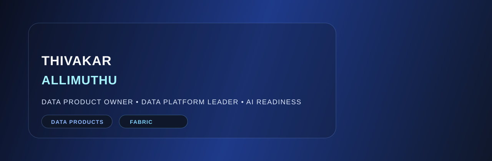

  

  
  
  
  

Data Product Owner and Data Platform Leader helping organizations turn data into trusted products, governed platforms, and AI-ready foundations.

---

## About me

I work across enterprise data strategy, analytics modernization, data governance, and AI readiness. My focus is on building the foundations that allow organizations to scale analytics, adopt AI responsibly, and generate measurable business value from data.

I help teams connect:

- strategy to execution
- governance to enablement
- data architecture to business outcomes
- analytics modernization to AI readiness

---

## Current focus

- Microsoft Fabric
- Enterprise AI Strategy
- AI Readiness Frameworks
- Data Product Operating Models
- Semantic Models and Knowledge Graphs
- Data Governance and Trust

---

## Featured portfolio

### Enterprise AI Readiness Framework
A practical framework for building trusted, AI-ready enterprise data foundations.

GitHub: https://github.com/thivakar-allimuthu/enterprise-ai-readiness-framework

### Enterprise Data and AI Transformation
Helping organizations design scalable, governed data ecosystems that support analytics, platform modernization, and AI adoption.

---

## Core expertise

- Data Product Ownership
- Enterprise Data Platform Leadership
- Data Governance
- Master Data Management (MDM)
- Analytics Modernization
- Platform Operations
- Data Strategy

---

## Professional goal

To help organizations transform data into strategic assets that power analytics, AI adoption, and business value at scale.

---

## Connect

- LinkedIn: https://www.linkedin.com/in/thivakar-allimuthu
- GitHub: https://github.com/thivakar-allimuthu

---
